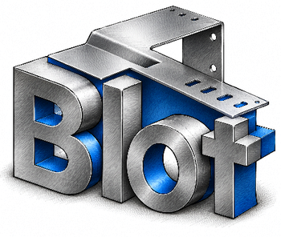

Blot / Application de conception pour la métallerie pilotée par l'IA

Cette application de conception 2D et 3D est spécialement adaptée aux besoins des professionnels de la métallerie et de la tôlerie.

Elle propose des fonctions de dessin **2D paramétrique** permettant de modifier rapidement les dimensions des pièces et d'automatiser la création de **familles de pièces similaires**, pour gagner un temps précieux.

La **modélisation 3D** permet de concevoir des pièces de tôlerie, de réaliser automatiquement leurs développés et de créer des ensembles mécano-soudés. L'intégration des pièces 3D dans un projet complet offre une **visualisation réaliste**, facilitant la compréhension des assemblages et la détection d'éventuelles erreurs de conception avant fabrication.

Pour simplifier son utilisation, l'application affiche uniquement les **fonctions adaptées au type de projets**: portails, escaliers, découpe de plaques, structures en profilés mécano-soudés, etc.

Enfin, grâce à son intégration avec les **intelligences artificielles génératives**, l'application peut être pilotée de manière traditionnelle ou à partir de simples **instructions écrites ou orales**, ouvrant la voie à une conception plus rapide, intuitive et accessible.

<a class="legion-launch" href="https://modelisation-3d.metallerie-blot.com/app/" target="_blank" rel="noopener noreferrer">Découvrir Blot</a>

Blot en bref

<ul>
<li><strong class="avec-fleche">100 % web</strong> Accessible directement en ligne.</li>
<li><strong>Technologies récentes</strong> Programmé en langage RUST, peut être connecté à des IA.</li>
<li><strong class="avec-fleche">Opensource</strong>Code modifiable selon les besoins.</li>
</ul>

