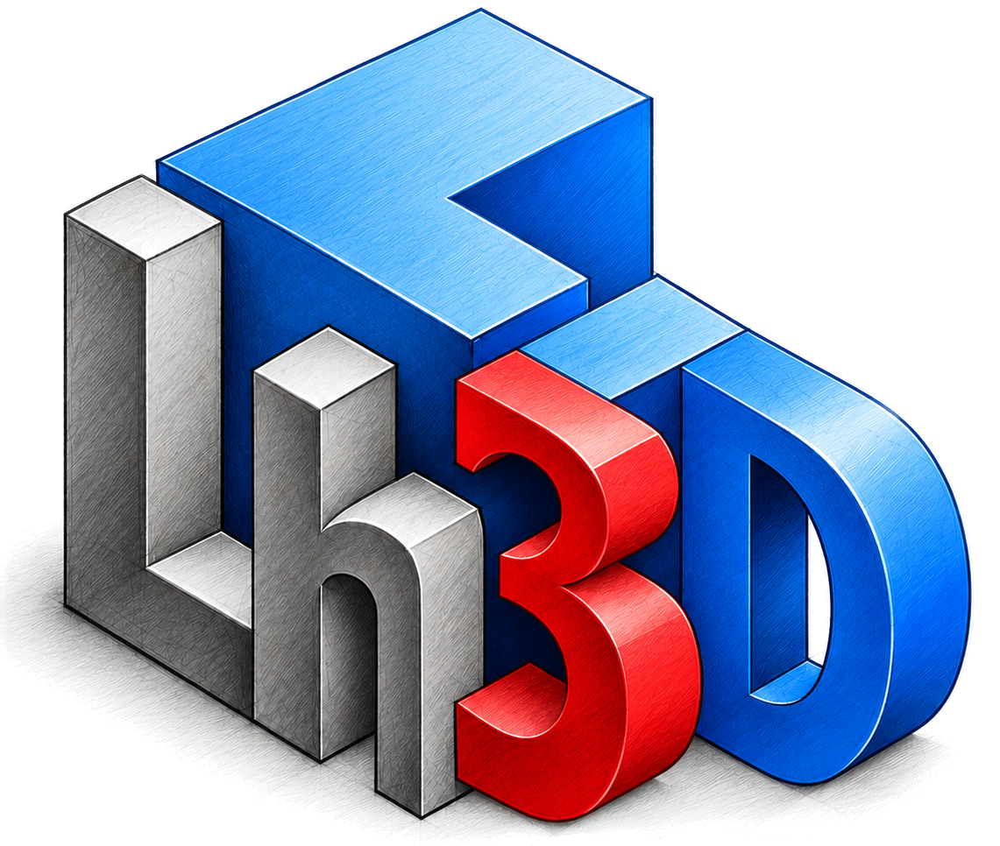
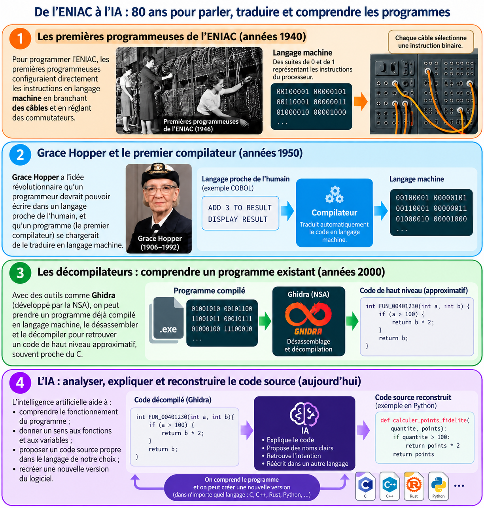

Une nouvelle génération de logiciels de modélisation 3D grâce à l'IA

L'intelligence artificielle permet aujourd'hui d'analyser le fonctionnement interne de logiciels existants et d'accélérer considérablement la création d'alternatives libres et **open source**.

Inspirée des meilleurs logiciels professionnels, [**Lg3D**](https://modelisation-3d.techno-melh.fr/app/) utilise des technologies web modernes comme le langage **Rust** pour fonctionner directement dans un navigateur web, sans installation sur l'ordinateur.

Grâce à son code source ouvert, l'application peut être **adaptée aux besoins des élèves**. Conçue dès le départ pour pouvoir se connecter **aux IA génératives**, elle ouvre la voie à de nouvelles façons de modéliser en 3D : avec la souris, comme dans les logiciels traditionnels, mais également à partir de simples instructions écrites ou orales.

<a class="legion-launch" href="https://modelisation-3d.techno-melh.fr/app/" target="_blank" rel="noopener noreferrer">Découvrir Lg3D ↗</a>

Lh3D en bref

<ul>
<li><strong class="avec-fleche">100 % web</strong> Accessible directement en ligne.</li>
<li><strong>Technologies récentes</strong> Programmé en langage RUST, peut être connecté à des IA.</li>
<li><strong class="avec-fleche">Opensource</strong>Code modifiable selon les besoins.</li>
</ul>

Un peu d'histoire...

