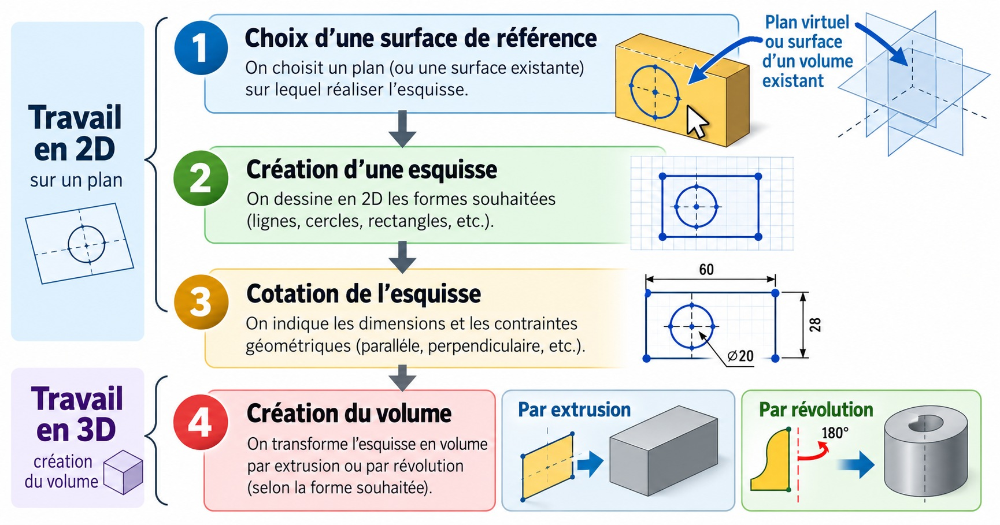

Réaliser un volume par révolution

 

Quel que soit le logiciel, la création d'un volume prismatique aux dimensions précises passe par 4 étapes

<ul>
<li><strong class="avec-fleche">1 ) Choix d'une surface de référence.</strong> Avec un crayon la surface de référence sur laquelle on dessine un polygone sera la surface d'une feuille, d'une table, ou un tableau.
Avec une souris informatique, ce sera un plan virtuel (XY XZ ou YZ) ou bien la surface d'un volume déjà existant.</li>
<li><strong class="avec-fleche">2 ) Réalisation d‘une esquisse en 2D</strong>        </li>
<li><strong class="avec-fleche">3 ) Cotation de l'esquisse</strong>( donner des dimensions précises au polygone ) 
La cotation se fait en indiquant des distances, des angles on peut imposer aussi des relations géométriques ( parallèle à, perpendiculaire à ... )   </li>
<li><strong class="avec-fleche">4 ) Création du volume</strong>La création du volume s'effectue soit par opération d'extrusion pour les formes prismatiques soit par révolution pour les formes cylindriques.   </li>
</ul>

Qu'appelle-t-on un polygone ?

C'est une ligne brisée fermée, l'intérieur du polygone forme une surface qui peut être ensuite transformée en volume par extrusion
Vous connaissez déjà des polygones particuliers comme les polygones réguliers (côtés de mêmes longueurs et mêmes angles) comme le carré ou l'hexagone ou ...

Vous avez maintenant découvert les principales étapes de la modélisation 3D 
**Vous pouvez passer au chapitre suivant pour mettre en pratique !**

